# DSO202 Practical 5: Environment Specific Configuration with Kustomize

## Environment

- kind cluster, 1 control plane, 2 workers
- kubectl v1.36.0
- kustomize v5.8.1, built into kubectl

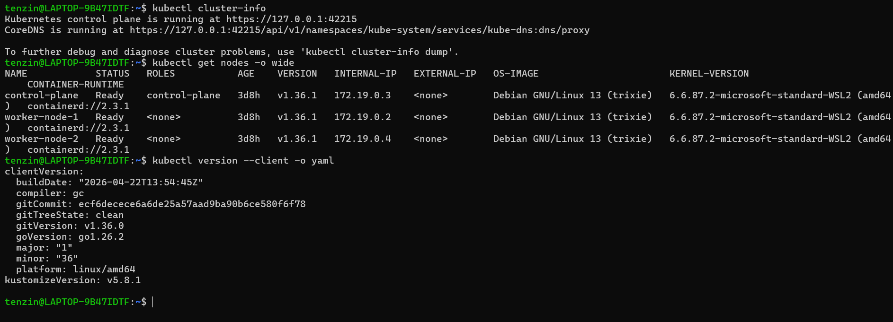

## Note on the missing example files

The lab page (https://hackmd.io/@sarojsanyasi/BJ6jbmdFze) has all ten tasks run commands against examples/webapp, but that folder was never provided anywhere on VLE, and the page itself has no link or attachment for it. I checked his other HackMD pages and searched for it, nothing came up. So I built the base and the dev, staging, prod, and qa overlays myself, using only the requirements each task states, the app itself is a plain nginx page since the lab says the learning target is Kustomize, not application code.

## Task 1: Reading the repository first

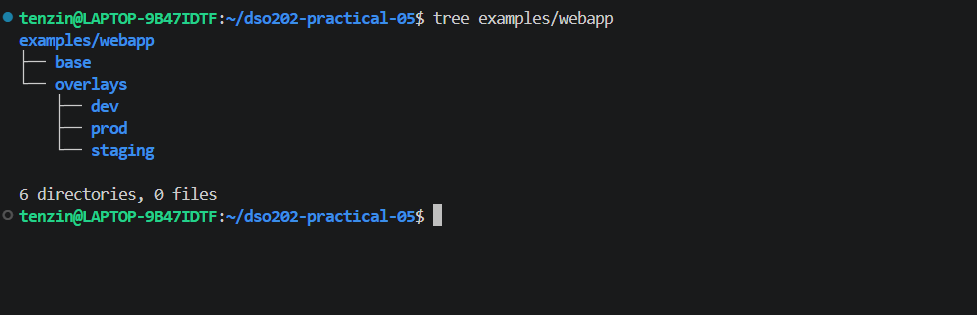

The four files in base exist once for all environments: deployment.yaml, service.yaml, index.html, kustomization.yaml. The values that differ between environments are the namespace, the environment label, the replica count, the page text, and prod's extra resource limits. Those differences live in each overlay's own kustomization.yaml and index.html, plus prod's separate patch-resources.yaml.

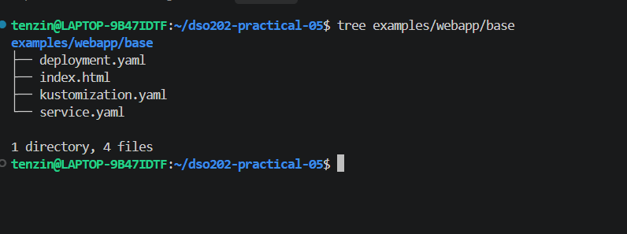

Once dev, staging, and prod overlays were built too, the full tree looked like this.

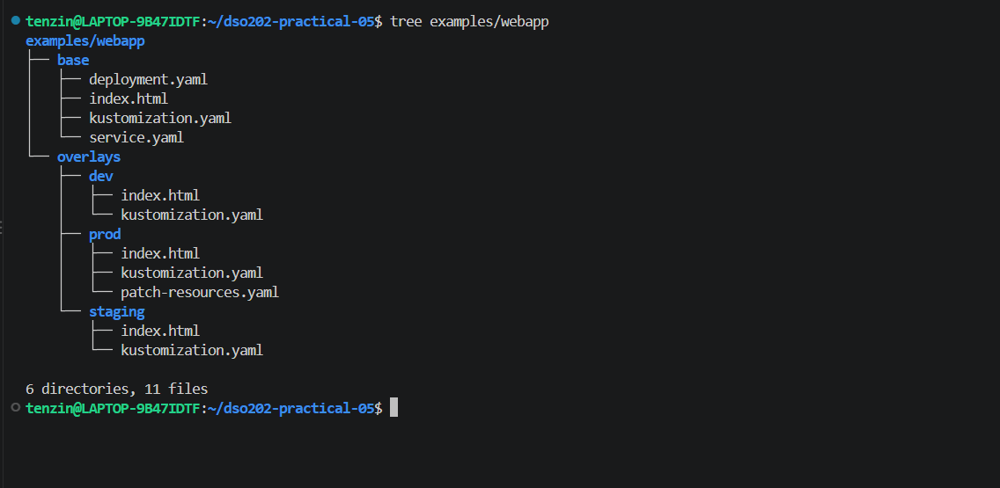

## Task 2: Rendering the base

I ran kubectl kustomize on the base folder without applying anything. It printed the ConfigMap, the Service, and the Deployment.

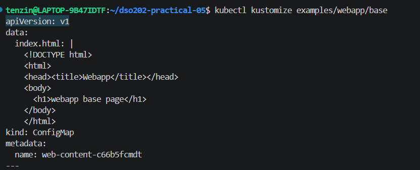
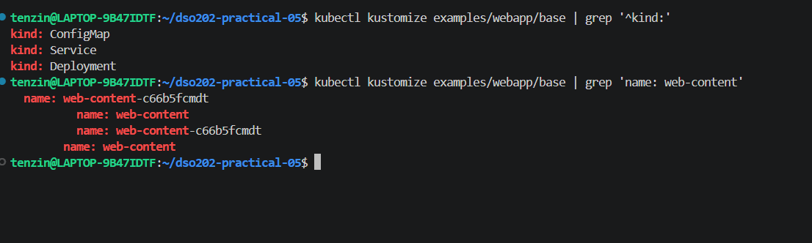

Checkpoint, why the generated ConfigMap name is not exactly web-content:

Kustomize's configMapGenerator adds a hash of the file's content to the end of the name it is given, so web-content becomes web-content-c66b5fcmdt. ConfigMaps are not versioned on their own, so if I edited index.html and kept the name web-content, Kubernetes would not notice anything changed since the name is identical, and the Deployment would keep using the old cached version. Putting a hash of the content into the name means any change to the file produces a new name, so the Deployment picks up the new ConfigMap automatically, and the old ConfigMap is left behind under its old name instead of being overwritten, so a rollback still has something to go back to.

## Task 3: Comparing dev and prod without touching the cluster

I rendered dev and prod to temp files and diffed them.

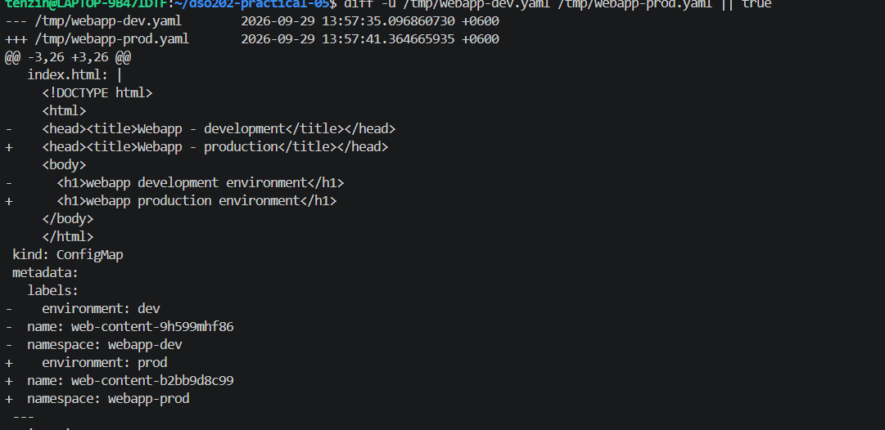
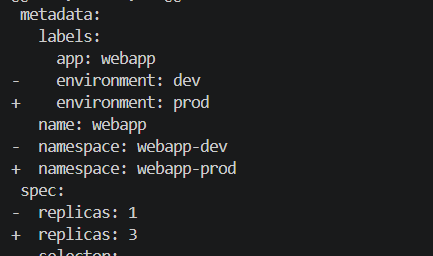
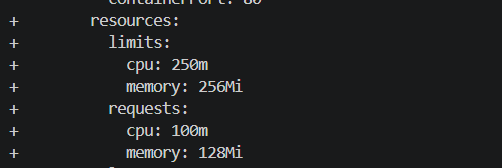

Five real differences: namespace, webapp-dev vs webapp-prod. Environment label, dev vs prod. Replica count, 1 vs 3. The generated page content and its ConfigMap hash. Prod's resource requests and limits, which dev has none of at all.

## Task 4: Deploying dev safely

I inspected the render first.

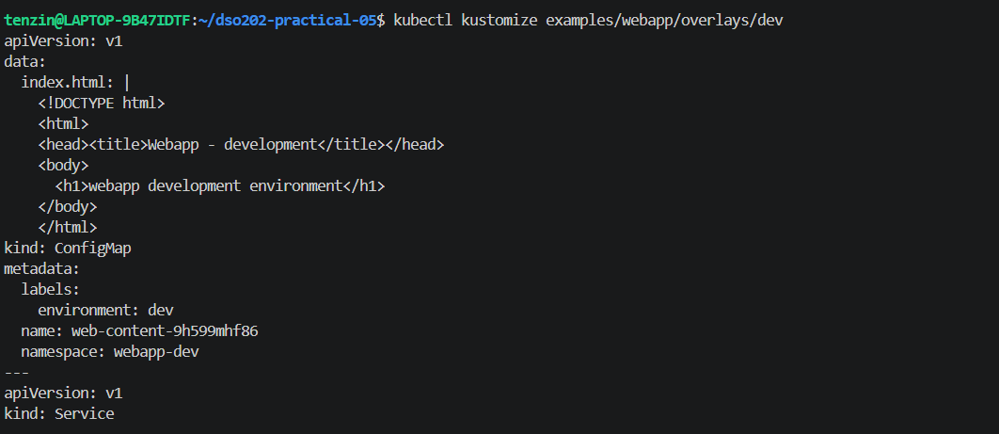
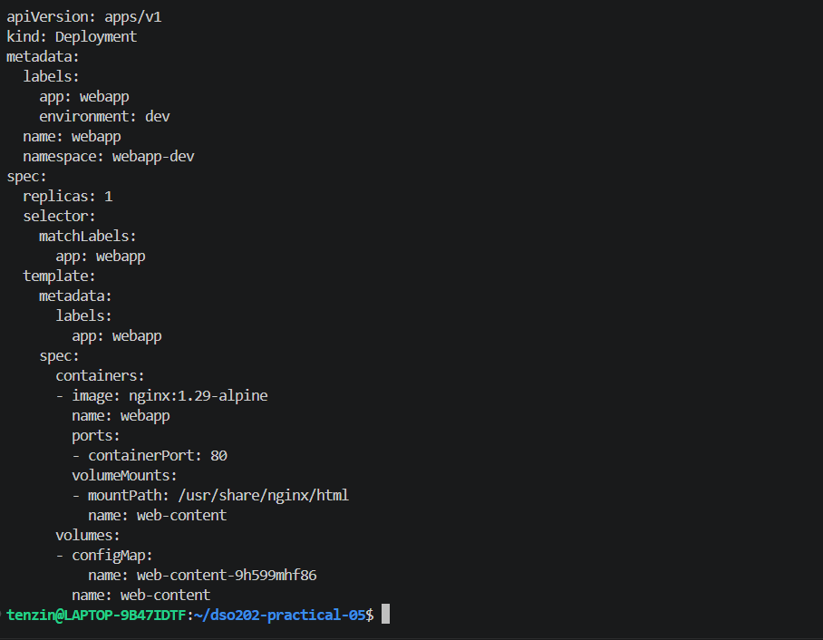

Then diffed against the cluster. It returned a NotFound error since webapp-dev did not exist yet, which is expected before a first deploy.

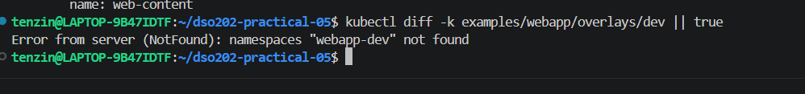

The apply itself failed the first time with the same NotFound error, since Kustomize's namespace field only stamps the name onto every object, it does not create the namespace. Dev's expected file list has only index.html and kustomization.yaml, no namespace.yaml, so I created the namespace manually first, then applied again.

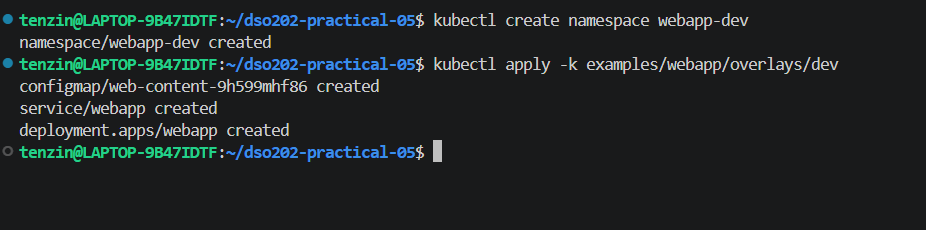
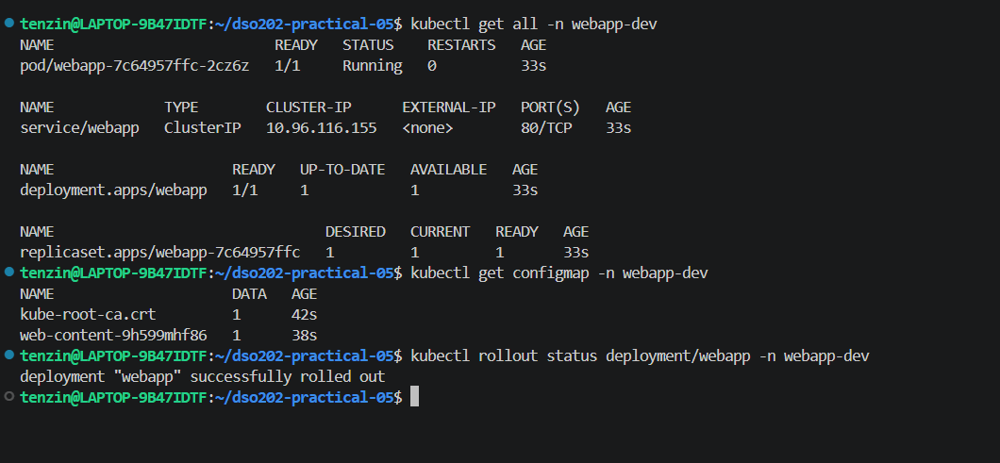

## Task 5: Reaching the application

I port forwarded the Service and curled it from a second terminal.

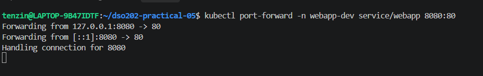
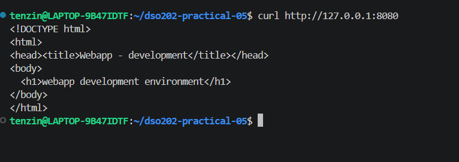

The response contained the word development, confirming the whole chain worked, browser request through the port forward, to the Service, to the pod, to the ConfigMap mounted page.

## Task 6: The ConfigMap hash and rollout chain

Before state, ConfigMap web-content-9h599mhf86, pod webapp-7c64957ffc-2cz6z.

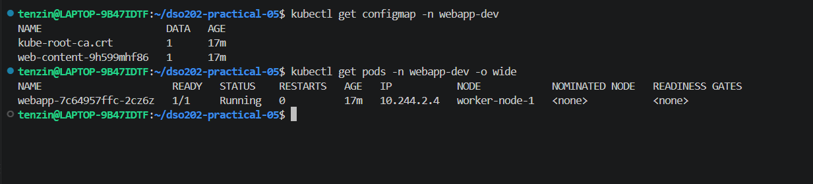

I changed the text in overlays/dev/index.html. Rendering before applying already showed a new hash, web-content-d7fdtd4b7b, before anything touched the cluster.

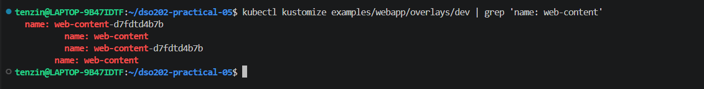

Applying it created a brand new ConfigMap object and rolled the Deployment, one old replica pending termination while a new one came up.

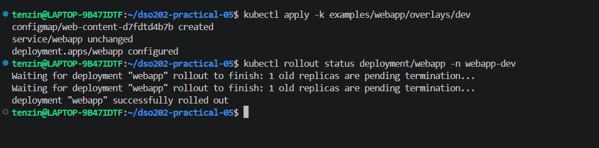

After state, the old ConfigMap web-content-9h599mhf86 was still sitting there untouched, the new one web-content-d7fdtd4b7b existed alongside it, and a completely new pod name appeared.

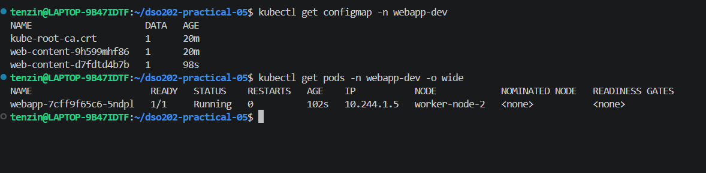

Explanation of the chain in my own words:

I changed the text in overlays/dev/index.html. That changed what Kustomize's ConfigMap generator produces, since the generator hashes the file's content into the ConfigMap's name, a different file means a different hash, so a brand new ConfigMap name. Kustomize also rewrites every place that referenced the old ConfigMap name, so the Deployment's volume block automatically pointed at the new name too. That counts as a real change to the Deployment's pod template, which is what actually triggers Kubernetes to do a rolling update, kill the old pod and start a new one with the updated volume reference. The old ConfigMap was not deleted anywhere in this, it is still sitting in the namespace unused, which is exactly what makes it possible to go back to the previous version if needed.

## Task 7: Deploying staging and prod

Same namespace issue as dev, so I created webapp-staging and webapp-prod manually first.

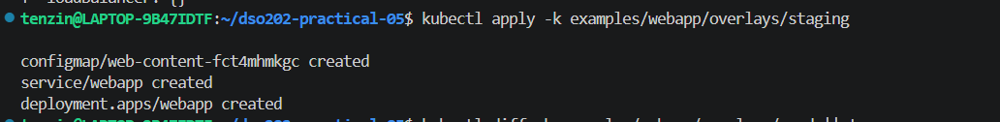

Prod's diff already showed the resource patch being applied, since staging has no resources field at all.

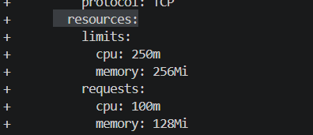
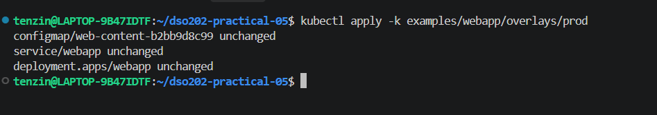
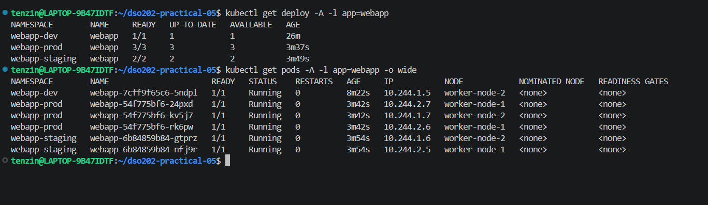

Replica counts by environment: dev 1, staging 2, prod 3.

## Task 8: Inspecting what the prod patch changed

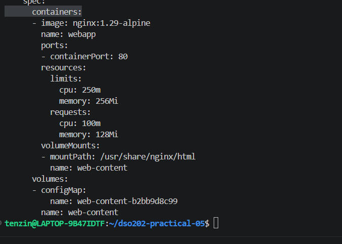

Were the base resource values deleted or merged? Merged. The base Deployment's container never had a resources field at all. patch-resources.yaml only adds name: webapp to find the right container, then the resources block. Everything else from the base, image, ports, volume mount, is still there untouched in the render.

Which environment owns the production specific resource policy? Only prod. Dev and staging's rendered YAML has no resources field at all, confirmed by staging's diff showing resources: {}. Only prod's kustomization.yaml lists the patch under patches.

Why is a patch better than copying deployment.yaml into prod? If prod had its own full copy of deployment.yaml, every future change to the base, a new image tag, a new volume mount, a renamed port, would need to be manually repeated in prod's copy too, and the two files could drift apart over time without anyone noticing. With a patch, prod only states the one thing that is actually different, so it inherits every future base change automatically and can only fall out of sync on the resource values themselves.

## Task 9: My own QA overlay

Requirements were namespace webapp-qa, 2 replicas, environment label qa, its own index.html, the same base, and an annotation added through a JSON 6902 patch, training.example.com/owner: qa-team, without copying deployment.yaml or service.yaml. This time I included namespace.yaml as an actual Namespace resource inside the overlay, since Task 9's expected minimum structure lists it explicitly, unlike dev, staging, and prod.

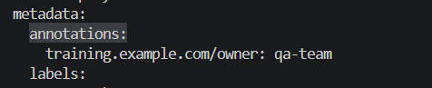

The annotation appeared in the rendered Deployment before I applied anything, exactly as the lab requires before proceeding.

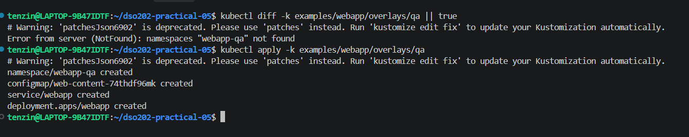
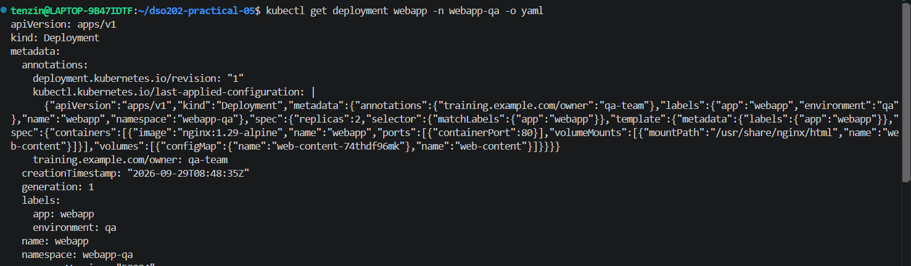

Strategic merge vs JSON 6902:

Prod's patch-resources.yaml is a strategic merge patch. It is written as a partial version of the real object, apiVersion, kind, metadata.name to identify which object, then only the fields being changed. Kustomize merges it into the base by matching the shape of the object, so it understands which container inside the Deployment to touch just from the structure.

QA's patch-annotation.yaml is a JSON 6902 patch. It is a list of exact operations, op: add, an exact path like /metadata/annotations, and a value. It does not look like the object at all, it is instructions for editing the object. Because it does not identify the target by shape, the kustomization.yaml has to name the exact target itself under patchesJson6902, group, version, kind, and name.

Strategic merge is easier to read and write for simple field changes, since it looks like the real object. JSON 6902 is more precise, useful for things a merge cannot express cleanly, like adding one specific entry into a map, or when the exact path matters more than the overall shape.

## Task 10: Cleanup

I deleted all four overlays.

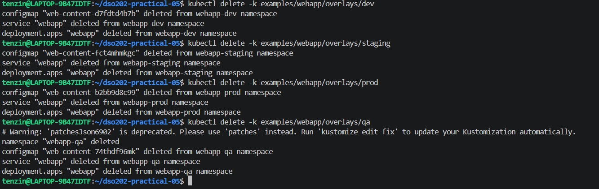

QA's namespace was deleted automatically since it was a real resource declared inside the overlay. Dev, staging, and prod's namespaces were left behind, since they were created manually outside Kustomize's control, only the workloads inside them were removed by the delete.

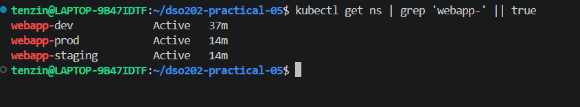

I deleted the three leftover namespaces manually to finish with a genuinely clean cluster.

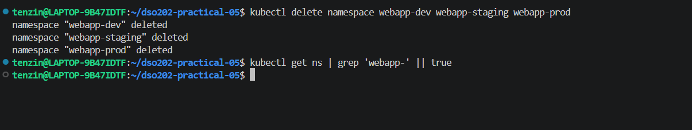

## Reflection: a real mistake

When I first ran kubectl apply -k on dev, it failed with namespaces webapp-dev not found. The lab's expected file list for dev, staging, and prod overlays only has index.html and kustomization.yaml, no namespace.yaml, so Kustomize's namespace field only stamps that name onto every object, it does not create the namespace itself. I had to create the three namespaces manually with kubectl create namespace before the applies would work. This showed up again at cleanup, kubectl delete -k on dev, staging, and prod removed the Deployment, Service, and ConfigMap but left the namespaces behind, since they were never resources Kustomize actually managed. Only the QA overlay, which I built with its own namespace.yaml as a real resource, deleted its namespace cleanly along with everything else. The rendered output caught this every time, once I actually looked at what apply -k was and was not creating instead of assuming it would handle everything.
